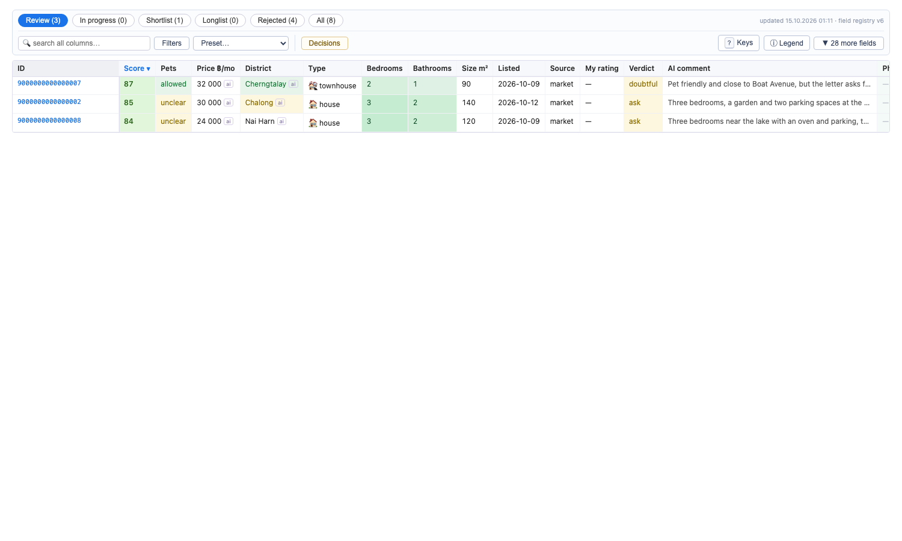

# ai-rent-assistant

[](https://github.com/bayanovea/ai-rent-assistant/actions/workflows/ci.yml)

Finding a long-term rental on Phuket means reading a few hundred Facebook
Marketplace ads a week that all say "fully furnished, pets negotiable". I built
this for my own move: it scrapes the ads into a local SQLite database, has
Claude read every ad and every photo against one written letter of
requirements, applies the hard rules itself, and hands back a single HTML page
where the forty tabs I would have opened are already scored, sorted and
mostly rejected. Everything runs on my laptop under my own Facebook login.
There is no API key and no service: the AI is Claude Code, reading files the
CLI writes.

## How it works


Each stage exists to spare the next one work. The scrape merges reposts before
the AI reads anything; the text pass auto-rejects on facts before I look; the
photo pass, the expensive one, runs only on what I left alive. The AI never
decides: it fills fields with a quote for each one, and `rules.py` turns the
fields into a status and a score, so the same facts always produce the same
outcome. My own `rate` and `reject` outrank both. [docs/pipeline.md](docs/pipeline.md)
has the stage table and who writes what.

## Try it in two minutes

You need Python 3.11 or newer. The scrape needs a logged-in Facebook session,
so the quick path starts after it: nine invented ads and the result file the
AI pass would produce for them ship in [`examples/`](examples/).

```sh
git clone https://github.com/bayanovea/ai-rent-assistant && cd ai-rent-assistant
python3 -m venv .venv && source .venv/bin/activate
pip install -e .
export RENT_ASSISTANT_HOME=$(mktemp -d)

rent-assistant seed examples/sample_listings.json
rent-assistant ai-apply examples/sample_ai_result.json
rent-assistant rate 9000000000000001 5 --reason "pets welcome, gated village"
rent-assistant export
open "$RENT_ASSISTANT_HOME/rentals.html"   # xdg-open on Linux
```



`seed` reports 8 inserted and 1 duplicate: the ninth ad is a repost of the
first under a new id, and the same content fingerprint that catches agency
reposts catches it here. `ai-apply` reports 8 analyses applied and 4
auto-rejected, each with its reason: Patong, 65,000 THB, a studio, pets
forbidden. The HTML page opens from disk with no server. The Review tab holds
the three ads nobody has looked at, sorted by score; the Shortlist tab holds
the one you rated; Rejected shows the four with "Reason" and "Decided by"
filled. Hover any AI-filled cell to see the quote it came from. Press `?` on
the page for the keys: `1`–`5` rate the row under the cursor, `r` rejects,
`d` merges it into a row you already reviewed, and the "Decisions" button
hands back the commands to run. `pip install -e '.[dev]' && pytest -q` runs
855 tests in about three seconds; none of them opens a browser.

To use it for real: `rent-assistant login` opens a browser for a one-time
sign-in, `rent-assistant scrape --bands 4` sweeps the price range,
`rent-assistant dedupe` merges the same flat listed by several agents, and
`/analyze` in a Claude Code session opened in the repository runs the text
pass. Your own letter goes to `$RENT_ASSISTANT_HOME/requirements.md`; the
tracked [`config/requirements.md`](config/requirements.md) is a sample that
shows the shape.

## Design decisions

**The AI layer is a Claude Code skill reading a batch file, not an API call.**
`ai-batch` writes one JSON file with the requirements letter, the field
registry and the raw text of every pending ad; the `/analyze` skill reads it
and writes a result file; `ai-apply` validates the result against the
registry and stores it. The photo and pets passes work the same way, with one
subagent per listing or per building so that images and search results never
enter the orchestrating session. Why: I already pay for Claude Code, the loop
is inspectable (both files sit in `$RENT_ASSISTANT_HOME/ai/`), and a bad
result file can be fixed by hand and re-applied. Cost: the pass needs a person
to open a session and type `/analyze`; there is no cron.

**The field registry is the single contract.** [`config/ai_fields.json`](config/ai_fields.json)
lists every AI-filled column once: key, type, allowed values, the prompt, the
pass that fills it (text, photo or both), and the version it was added in. The
batch assembler, the result validator, the rules and the HTML export all read
it. Adding a column is one JSON entry plus a version bump, and the bump
re-queues exactly the rows that lack the new field, hatched in the table until
they are re-analysed. Cost: an unknown key in a result file rejects the whole
file, on purpose, so a typo costs a re-run rather than a half-migrated row.

**The rules decide; the AI describes.** A result carries fields and a quote
for each, plus a one-sentence verdict. Status and score come from `rules.py`
alone: six conditions auto-reject (pets forbidden by the ad, a building whose
house rule I confirmed, Patong, above 40,000 THB, a studio, under 35 m²), and
everything else is a remark. The verdict sentence must open with one of five
words, which the table shows as a tag; a sentence that matches none leaves
the cell blank instead of guessing. Cost: the weights are mine, not learned,
and they once pinned 352 of 1,123 rows at the score ceiling until I re-measured
the spread. That trap is written down in [CLAUDE.md](CLAUDE.md).

**Dedupe before anyone reads anything, with signals that identify a flat
rather than describe it.** The same house appears under six ids from four
agencies. A repost is caught at insert time by a content fingerprint; near
duplicates are merged on the ad text at 90% word overlap with a 40-word floor,
or on two of the first three photo hashes. Price plus bedroom count is not a
signal: half the island is a one-bedroom at 25,000. Cost: a merge has no undo,
so the pairwise `d` key in the table only merges when a hard signal agrees,
and the one path that merges on my word alone is a flag I have to type.

**The requirements letter is Markdown the AI reads, not code.** The letter to
the agent, the priority checklist and the district table are one file pasted
into every batch. Changing what "good" means is editing prose. The code
enforces only the hard rules and the district scale. Cost: the district
scale lives in two places, the prose and `rules.py`, and they have to be
changed together, which is the second trap in `CLAUDE.md`.

**What cannot be rebuilt lives outside the database.** A scrape can be
repeated and an AI pass re-run, so `rentals.db` is disposable. My decisions,
the building policies I confirmed after a web search, and the log of every
message actually sent live in three JSON files that no `init_db` touches. Why
the send log: a message to a real person is the one irreversible action here,
and the file plus a stage in the decisions file are two independent guards
against sending it twice. Cost: the export has to mirror the files into the
database on every run to join against them.

## Status and limits

Used daily from August to October 2026: 4,252 listings scraped, 2,176 of them
recognised as reposts, 1,396 analysed by the text pass, 143 buildings
researched for their pets rule, 311 decisions of mine. Every stage above
works end to end, including Messenger outreach.

What is rough. `storage.py` is 4,200 lines and `cli.py` 3,200: the SQLite
layer, the dedupe signals and the whole HTML export grew in one module, and
the CLI accumulated every command of five iterations. Splitting them is the
next refactor, not this release. The scraper matches Facebook's own UI text
and was verified against a Russian-locale account, so those marker tables are
the one place Cyrillic remains in the code; English markers exist where I
could confirm them. Selectors are tied to Facebook's DOM and will break
without notice.

There is no eval harness for the AI stages yet. The first one would take 50
hand-labelled ads and measure field extraction (pets, price, size, district)
against the labels, then verdict agreement, so that a prompt change can be
compared instead of eyeballed. That is the next step.

Messenger is in the repository and off by default: `messages send` prints
drafts unless `--apply` is given, asks for confirmation, stops after ten
messages, and stops at once when Facebook shows its daily limit dialog.

What I would do differently: start with the result file as the contract and
treat the table as one renderer of it, and give the score a budget from day
one instead of discovering the ceiling on live data.

Scope: this is a personal tool. It runs under the user's own Facebook account
in a browser profile on the user's machine, waits three to seven seconds
between detail pages, downloads photos only for listings the user kept, and
does not redistribute anything it reads. It is not a service and has no
server.

<details>
<summary>Commands</summary>

| Command | What it does |
|---|---|
| `rent-assistant login [--profile NAME]` | one-time headed sign-in; the session persists in the browser profile |
| `rent-assistant scrape [--bands N] [--no-photos] [--ids ID…] [--dry-run]` | sweep Marketplace, upsert into the DB, fingerprint the first three photos |
| `rent-assistant scrape-groups [--group SLUG] [--ids ID…]` | the same for Facebook group posts |
| `rent-assistant dedupe [ID [--into ID]] [--dry-run]` | merge reposts and the same flat under several ids; one row, or the whole base |
| `rent-assistant seed FILE` | load listings from a JSON file instead of a scrape |
| `rent-assistant ai-status` / `ai-batch` / `ai-apply FILE` | the text pass around the `/analyze` skill |
| `rent-assistant ai-field list` / `add --key … [--backfill]` | inspect and grow the field registry |
| `rent-assistant photos-fetch` / `photo-batch` / `photo-apply FILE` / `photo-hash` | the photo pass around `/photo-analyze` |
| `rent-assistant buildings-batch` / `buildings-apply FILE` / `buildings list\|set\|conflicts` | the pets pass around `/pets-policy`; only `buildings set` makes a policy count |
| `rent-assistant rate ID 1–5` / `reject` / `unreject` / `shortlist` | your decisions; a rating moves the row off the Review tab |
| `rent-assistant contact` / `schedule-viewing` / `mark-viewed` / `clear-stage` | what happened after the shortlist |
| `rent-assistant messages sync\|send\|status\|classify-batch\|classify-apply` | Messenger outreach around the `/messages` skill; `send` is a dry run without `--apply` |
| `rent-assistant check-alive` | drop shortlist rows Facebook reports as gone |
| `rent-assistant export` | rebuild `rentals.csv` and `rentals.html` from the DB |

[docs/cli.md](docs/cli.md) has every flag.

</details>

<details>
<summary>Where things live, and the environment</summary>

Everything the machine produces goes into `$RENT_ASSISTANT_HOME`, default
`~/.rent-assistant`: `rentals.db`, `rentals.csv`, `rentals.html`, `photos/`,
`ai/` (batch and result files), `browser-profile/` (the Facebook session,
treat it as a secret), and the three files that cannot be rebuilt:
`decisions.json`, `buildings.json`, `messages_sent.json`. Your own
`requirements.md` goes there too and takes precedence over the tracked
sample. Everything you edit under version control is in `config/`.
Details: [docs/data-layout.md](docs/data-layout.md).

| Variable | Meaning |
|---|---|
| `RENT_ASSISTANT_HOME` | the data directory above |
| `RENT_ASSISTANT_PAGE_LOAD_TIMEOUT_MS` | detail-page navigation timeout, default 30000 |
| `RENT_ASSISTANT_CONTENT_TIMEOUT_MS` | wait for the ad body to render, default 15000 |

There are no secrets and no `.env`: the only credential is the browser
profile created by `login`.

`pip install -e .` is required rather than a convenience: `config/` is read
from the checkout, not packaged into a wheel.

</details>

<details>
<summary>More</summary>

- [docs/pipeline.md](docs/pipeline.md) — the five stages, who writes what, which can run alone
- [docs/scraping.md](docs/scraping.md) — price bands, the detail budget, repairs, troubleshooting
- [docs/ai-enrichment.md](docs/ai-enrichment.md) — the text pass and the field registry
- [docs/photo-analysis.md](docs/photo-analysis.md) — the photo pass, with measurements
- [docs/pets-policy.md](docs/pets-policy.md) — one house rule per building
- [docs/dedupe.md](docs/dedupe.md) — five duplicate signals and the one that was removed
- [docs/messages.md](docs/messages.md) — Messenger outreach and its guards
- [docs/plans/completed/](docs/plans/completed) — the implementation plan of each iteration
- [CLAUDE.md](CLAUDE.md) — the traps a coding agent must not walk into
- [LICENSE](LICENSE) — MIT

</details>
