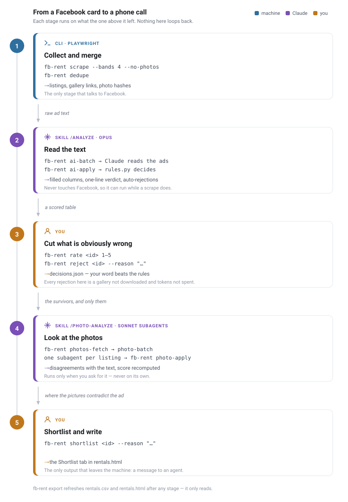
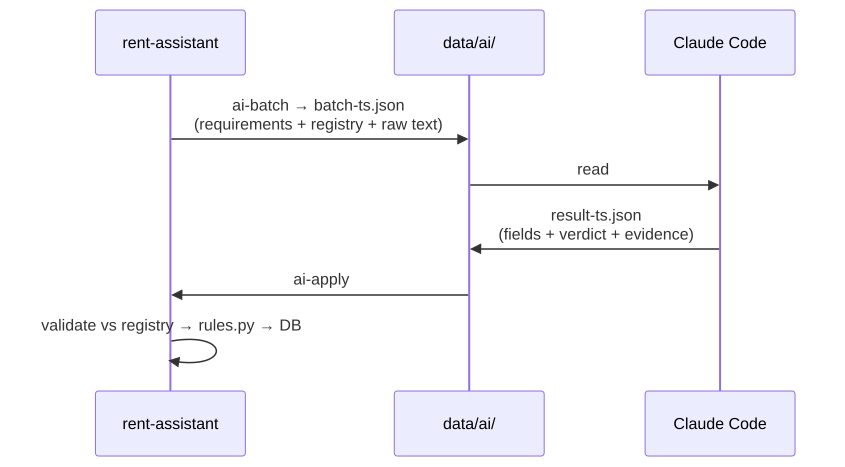

# Pipeline

The project is a funnel: a few hundred Facebook cards go in, a handful of flats
worth a phone call come out. Every stage exists to throw away work the next
stage would otherwise pay for — which is why the order matters and why two of
the stages are yours, not the machine's.



<sub>Diagrams live in [`diagrams/`](diagrams) as SVG. The two small ones below
come from `.mmd` sources via `scripts/render-diagrams.sh`; this one is drawn by
`scripts/gen-pipeline-diagram.py` — edit its `STAGES` table, not the SVG.</sub>

You read the table twice, and the two readings are different work. The first
one (stage 3) is a gate: what you throw out never costs a gallery download or a
photo token. The second (stage 5) is the decision, taken with the pictures in
front of you — the photo pass exists to make that reading better, not to
replace it.

## Stage by stage

| # | Step | Who runs it | Reads | Writes |
|---|------|-------------|-------|--------|
| — | `fb-rent login` | you, once every 1–4 weeks | — | `data/browser-profile/` |
| 1 | `fb-rent scrape`, then `fb-rent dedupe` | you / cron | Facebook | `listings`, `photo_hashes`, `duplicates`, `photos/<fb_id>/` |
| 2 | `/analyze` skill | Claude Code (Opus) | `listings.description`, `config/requirements.md`, `config/ai_fields.json` | `ai_analysis.data_json`, auto-rejections |
| 3 | reading the table | **you** | `data/rentals.html` | `data/decisions.json` |
| 4 | `fb-rent photos-fetch`, then `/photo-analyze` | you, then Claude Code (Sonnet subagents) | stored gallery URLs, then the photo files | `photos/<fb_id>/`, `ai_analysis.photo_data_json` |
| 5 | reading the table again | **you** | `data/rentals.html` | `data/decisions.json` |
| — | `/pets-policy` skill | you ask for it, occasionally | the web, one search per building | `data/buildings.json` (proposals), then your confirmations |
| — | `fb-rent export` | after anything above | the DB + `decisions.json` + `buildings.json` | `rentals.csv`, `rentals.html` |

Stage 3 is not a formality. The photo queue skips everything you rejected, so
every listing you throw out by hand before stage 4 is tokens not spent. Neither
`/analyze` nor `ai-status` will offer to start the photo pass — you ask for it.

It is also the stage that stalls, and the reason is arithmetic: it is the only
one that costs a person's attention per row. So the table takes decisions from
the keyboard — `↓ ↑` to walk, `1`–`5` to mark, `r` to reject — and hands back a
block of `fb-rent rate` / `reject` commands to paste in one go, rather than
asking for one command per listing. See [data-layout.md](data-layout.md#the-html-export).

Which stages can run alone, and which genuinely depend on each other, is the
subject of [the dependency notes below](#what-can-run-on-its-own).

### Beside the pipeline, not in it

Two passes are not stages at all: they have no place in the order above and
they run only when you ask.

The **photo pass** is the expensive half of stage 4 and waits for stage 3, so
that what you already threw out costs nothing.

The **pets pass** (`/pets-policy`) is not keyed by listing at all. It looks up
one condo's house rule about animals, once, and reuses the answer for every
flat in that building — including the ones scraped next week. It is the only
part of the project that reads the open web, and the only one whose findings
cannot act until you confirm them by hand: research writes `proposed`, and a
`proposed` building changes nothing anywhere. Details and the four policy
values are in [pets-policy.md](pets-policy.md).

## Who decides what

Extraction is the AI's job. The *decision* is not, and the final word is not
the AI's either.



- **The AI extracts.** Fields, each with a confidence and a quote it can be
  traced back to. It never writes `verdict`, `score` or `status`; values for
  those in a result file are ignored.
- **`rules.py` decides.** Six conditions auto-reject; the district is worth up
  to ±9 points of the score. A confirmed building policy is worth no points at
  all, in either direction — it either rejects or says nothing. The same facts
  therefore always produce the same outcome — see
  [ai-enrichment.md](ai-enrichment.md).
- **You override.** `decisions.json` beats the rules in both directions, and
  with `buildings.json` it is what a DB wipe would actually lose. Both are
  mirrored back into the DB on the next `export`.

The two AI passes write into separate columns and are merged on read, so
neither can clobber the other: drop the photo columns and the text analysis is
untouched.

## The batch contract

Both passes talk to Claude Code through files, not an API. The CLI's whole job
is to write a batch out and read a result back.



A result file is rejected wholesale if it carries a key the registry does not
know — new signals go into `proposed_new_fields`, and you decide whether they
become columns ([`ai-field add`](cli.md#fb-rent-ai-field)). The photo pass
mirrors this with `photo-batch` / `photo-apply`, keyed on `photos_hash` instead
of the text hash.

## The order of work for a wide sweep

Downloading galleries costs a second or two per listing and hundreds of
megabytes over a big run, and most of those listings will be rejected on their
text alone. So a wide sweep splits collection from downloading:

```sh
fb-rent scrape --bands 4 --max 60 --days 7 --detail-cap 150 --no-photos
fb-rent dedupe
# /analyze  — the text pass, does not touch Facebook
# you read the table and cut what is obviously wrong
fb-rent photos-fetch --all      # only for what survived
# /photo-analyze
```

The stored gallery URLs are signed and expire in about a week, which is what
makes this order possible at all — and what bounds it. Past the expiry only the
detail page can hand out fresh links (`fb-rent scrape --ids <fb_id>`).

## What can run on its own

Every stage is its own command, and most of them can be run in isolation.

| Stage | Alone? | Needs | Network |
|---|---|---|---|
| `login` | yes | — | Facebook |
| `scrape` | yes | a live session | Facebook |
| `dedupe` | yes, any time | the DB | no |
| `photo-hash` | yes | stored gallery URLs | the CDN |
| `/analyze` | yes | rows that have text | **no** |
| `photos-fetch` | no | the text pass has run | the CDN |
| `/photo-analyze` | no | photos on disk | no |
| `/pets-policy` | yes | rows with a `project_name`, i.e. the text pass | the open web |
| `export` | yes, any time | the DB | no |

Only three couplings are real:

- **The photo pass needs the text pass.** `fetch_pending_photos` joins
  `ai_analysis`, so a listing nobody has read yet is not a candidate — and
  `photos-fetch` works off the same queue, which is why downloading galleries
  before `/analyze` finds nothing to download.
- **`photos-fetch` before `photo-batch`.** The batch is built from the files on
  disk, not from the links.
- **Everything before `export`.** It only reads.

Note what is *not* in that list: `photo-hash` does not depend on the photo pass
at all. It is a dedupe signal, it runs inline in every `scrape` (including
`--no-photos`), and `fb-rent photo-hash` only exists to catch up rows scraped
before the stage did.

### What can run at the same time

`/analyze` never contacts Facebook, so it can run alongside a scrape — that is
how the night of 26 August went, 592 detail pages and the text pass at once.

What cannot overlap is two `scrape` runs: there is one browser profile and the
persistent context holds it.

### Order that saves work

- **`dedupe` before `photos-fetch`.** Merging deletes the photo directory of
  the rows it absorbs, so galleries downloaded first are downloaded for
  nothing.
- **`/analyze` before any photo download.** `ai-apply` purges the photos of
  what it auto-rejects. On the 26 August run that was 470 rows of 779 — two
  thirds of the galleries would have been fetched and thrown away. This is what
  `--no-photos` on a wide sweep is for.
- **Do not postpone `photos-fetch` past a week.** The signed links expire;
  after that only `scrape --ids` can produce fresh ones.
